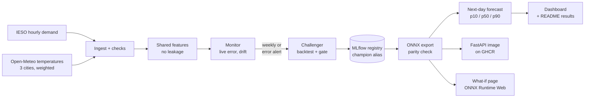

# Ontario Electricity Demand: Production ML Forecasting System

[](https://github.com/dvskaff/ontario-demand-forecasting/actions/workflows/ci.yml)
[](https://github.com/dvskaff/ontario-demand-forecasting/actions/workflows/pipeline.yml)
 
 


* **Dashboard:** [tomorrow's forecast, updated daily](https://dvskaff.github.io/ontario-demand-forecasting/)
* **What-if:** [make tomorrow warmer or colder](https://dvskaff.github.io/ontario-demand-forecasting/whatif.html)
* **API:** [reference for the forecast API](https://dvskaff.github.io/ontario-demand-forecasting/api.html)

How much electricity will Ontario need tomorrow, hour by hour, and how sure are we? This project is an end-to-end
ML system that answers that every day from public IESO data. It covers training, a model registry, a promotion
gate, serving and monitoring, all automated with GitHub Actions:

* **Model:** LightGBM quantile regression (10th, 50th, 90th percentiles) gives a forecast and an 80% prediction
  interval for each hour, with features shared between training and serving.
* **Registry and gate:** every retrain is an MLflow run and a registered model version. A new version becomes
  `champion` only if it beats the seasonal-naive baseline and matches or beats the current champion on the most
  recent days neither model has seen (up to a week).
* **Serving:** the champion is exported to ONNX (parity-checked against LightGBM to within 1 MW) and served by a
  FastAPI app in a Docker image. GitHub Actions builds the image, smoke-tests it and pushes it to GitHub Container
  Registry whenever the champion changes.
* **Monitoring:** every issued forecast is scored once the day is over, which gives the live error. Evidently checks
  input drift against the same weeks a year earlier, and a jump in live error triggers an early retrain.
* **What-if in the browser:** the [weather what-if page](https://dvskaff.github.io/ontario-demand-forecasting/whatif.html)
  runs the champion's ONNX models with ONNX Runtime Web. Move the slider and tomorrow's temperatures shift by up to
  ±10 °C; the page rebuilds the temperature features (the same formulas as training, checked by the tests) and
  forecasts again, with the 80% interval.

## Results

Rewritten automatically after every run.

<!-- RESULTS:START -->
_IESO demand through 2026-11-07 · champion model v1 (data through 2026-11-05) · last run 2026-11-08 20:44 UTC_

**Next-day forecast (2026-11-08):** peak 17,255 MW at hour ending 18:00 EST (80% interval 16,434–17,574 MW)

| Accuracy | MAPE | Daily peak error | 80% interval coverage* |
|---|---|---|---|
| Backtest, LightGBM quantile (12 monthly folds) | 2.71% | 2.29% | 63% |
| Baseline: same hour last week | 6.52% | 6.00% | – |
| Baseline: same hour yesterday | 4.68% | 3.92% | – |
| **Live**, issued forecasts, last 2 days | 3.52% | 3.62% | 40% |

_*Backtest coverage is before the conformal calibration of the interval; the live row is after._

**Registry:** 1 model version(s) in MLflow · **Inputs vs. same weeks last year (Evidently):** 6 of 6 columns shifted (this period was +2.2 °C vs. last year, with demand +0.7%)

**API image:** `docker run -p 8000:8000 ghcr.io/dvskaff/ontario-demand-api:latest`
<!-- RESULTS:END -->

## Architecture



<details><summary>Every step in detail</summary>

```
IESO hourly demand (EST, public CSV) ─┐
Open-Meteo temperatures (3 cities,   ─┤  src/demand/ingest.py      range checks, missing-hour count
 population-weighted; history+forecast)┘
                                        ▼
                     src/demand/features.py   calendar + holidays, heating/cooling degrees, demand lags that only
                                              use data up to the end of the previous day (no leakage)
                                        ▼
 daily ─► monitor: score past forecasts (live MAPE, interval coverage) ─► retrain? (weekly / no champion / alert)
                                        ▼                                         │
                                        │     challenger: rolling-origin backtest (12 monthly folds) + gate on
                                        │     unseen days vs champion ─► refit ─► ONNX export + parity ─► MLflow run +
                                        │     registered version ─► alias `champion` (only if the gate passes)
                                        ▼
                     forecast next day with the champion (ONNX Runtime) ─► forecast log
                                        ▼
       Evidently drift report · dashboard + API reference + what-if page (GitHub Pages) · model bundle ─► Docker image (GHCR)
```

</details>

### API

```bash
docker run -p 8000:8000 ghcr.io/dvskaff/ontario-demand-api:latest
curl -s localhost:8000/health
curl -s localhost:8000/forecast/example | curl -s -X POST localhost:8000/forecast -H 'Content-Type: application/json' -d @-
```

`POST /forecast` takes the 168 hours before the day (demand and temperature) plus the day's 24 forecast temperatures,
and returns 24 hourly forecasts with p10/p50/p90. The image contains only FastAPI, ONNX Runtime and the shared feature
code: no LightGBM, MLflow or training code.

### Honest evaluation

* **Backtest:** each of the last 12 months is forecast by a model trained only on earlier data, using observed
  temperatures. That's a best case for the weather input.
* **Live:** each forecast as it was actually issued, with the weather forecast available at the time. That's the
  number to trust; it is expected to be somewhat worse.
* **Baselines:** same hour last week and same hour yesterday.

## Repository layout

```
src/demand/   config · ingest · features (shared with the API) · model (quantile LightGBM, backtest, ONNX)
              registry (MLflow) · monitor (live scoring, Evidently drift) · pipeline · report · readme
              whatif (exports the champion and tomorrow's features for the in-browser what-if page)
              fixture.py: SYNTHETIC demand/weather for tests (pages built from it say so)
scripts/      fetch_web_runtime.sh: fetches ONNX Runtime Web from npm for the what-if page
serving/      app/main.py (FastAPI) · requirements.txt (API image only)
Dockerfile    the API image
tests/        no-leakage and training/serving feature parity, ingestion, models + ONNX parity, API, multi-day runs
.github/      ci.yml (lint, tests, build + smoke-test the image) · pipeline.yml (daily run, image push to GHCR)
```

## Run it

Everything runs in GitHub Actions. Locally:

```bash
pip install -r requirements-dev.txt
pytest -q
PYTHONPATH=src python -m demand.pipeline --fixture    # offline, synthetic data
PYTHONPATH=src python -m demand.pipeline              # real IESO + Open-Meteo data
```

Data: [IESO](https://www.ieso.ca/power-data) public reports · weather by [Open-Meteo](https://open-meteo.com/) (CC BY 4.0).
Code: MIT license.
